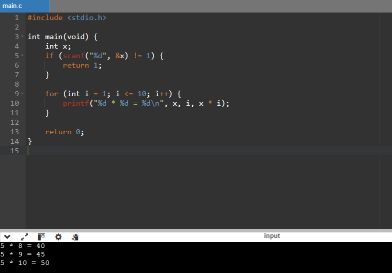

# Calculadora de Tabuada em C

## Descrição

A Calculadora de Tabuada em C é um programa desenvolvido na linguagem C que recebe um número inteiro e exibe sua tabuada de multiplicação, do 1 ao 10.

O programa é útil para estudantes que desejam praticar matemática básica e para iniciantes que estão aprendendo conceitos de programação, como entrada de dados, estruturas de repetição e saída de informações.

## Demonstração

A imagem abaixo mostra uma captura real da execução do programa no terminal.



### Exemplo de resultado

Ao informar o número `2`, o programa apresenta:

```text
2 * 1 = 2
2 * 2 = 4
2 * 3 = 6
2 * 4 = 8
2 * 5 = 10
2 * 6 = 12
2 * 7 = 14
2 * 8 = 16
2 * 9 = 18
2 * 10 = 20
```

## Instalação e pré-requisitos

Para compilar e executar o programa, são necessários:

- Um compilador C, como o GCC.
- Um terminal para executar os comandos.

O programa utiliza apenas a biblioteca padrão `stdio.h`, sem dependências externas.

### Verificar a instalação do GCC

Abra o terminal e execute:

```bash
gcc --version
```

Se o compilador não estiver instalado, instale e configure um compilador C compatível com seu sistema operacional.

### Compilar o programa

Na pasta que contém o arquivo `main.c`, execute:

```bash
gcc main.c -o tabuada
```

## Uso e exemplos

### Executar no Windows

Depois de compilar o programa, execute:

```powershell
.\tabuada.exe
```

### Executar no Linux

Depois de compilar o programa, execute:

```bash
./tabuada
```

### Exemplo de uso

Quando o programa estiver aguardando uma entrada, digite `2` e pressione Enter.

A saída esperada será:

```text
2 * 1 = 2
2 * 2 = 4
2 * 3 = 6
2 * 4 = 8
2 * 5 = 10
2 * 6 = 12
2 * 7 = 14
2 * 8 = 16
2 * 9 = 18
2 * 10 = 20
```

Você pode informar outros números inteiros para consultar diferentes tabuadas. Se a entrada não for um número inteiro válido, o programa encerra com código de erro.

## Estrutura do projeto

```text
meu-projeto/
├── README.md
├── LICENSE
├── main.c
└── assets/
    └── demo.png
```

### Arquivos e pastas

- `README.md`: documentação do projeto, com descrição, instalação e exemplos de uso.
- `LICENSE`: arquivo com o texto completo da licença adotada.
- `main.c`: código-fonte do programa em C.
- `assets/demo.png`: imagem real da execução do programa.

## Licença

Este projeto utiliza a licença MIT. Consulte o arquivo [LICENSE](LICENSE) para acessar o texto completo da licença e conhecer as condições de uso, modificação e distribuição.